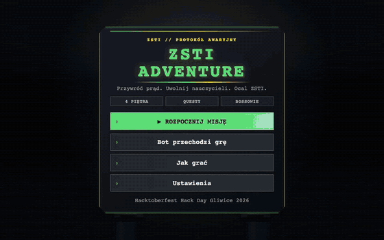
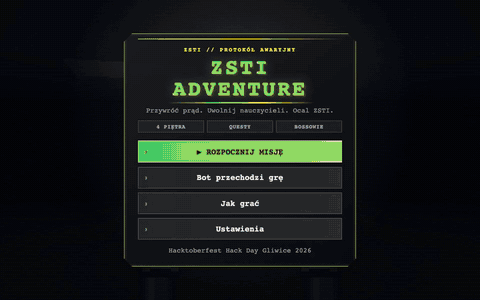
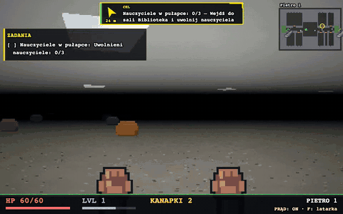
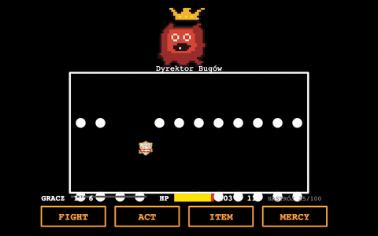
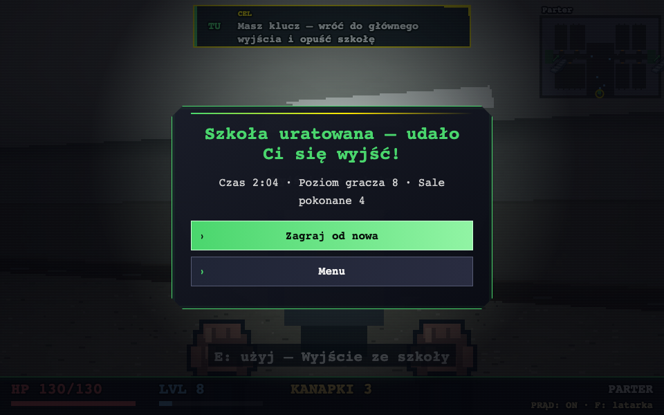
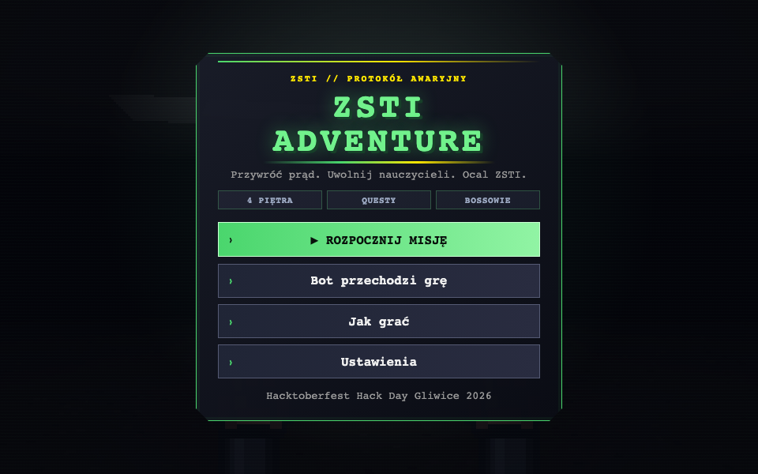

# ZSTI ADVENTURE

**Doom spotyka Undertale w ZSTI Gliwice.** Raycaster 3D w czystym HTML/JS, cztery piętra szkoły odtworzone ze zdjęć, rozmowy i walki turowe w stylu Undertale. Do tego bot, który przechodzi całą grę sam.

**[Zagraj w przeglądarce](https://mateuszcopik7.github.io/dziad-promptowanie-hacktoberfest/)** · bez instalacji, bez buildu, bez zależności

Hacktoberfest Hack Day Gliwice 2026 · temat **Automation & Emulation**



*Bot przechodzi całą grę sam w 2,5 minuty: rozmowy, questy, schody, walki, finał. Nagranie przyspieszone 10x.*

## Co tu jest

| | |
| --- | --- |
| **Szkoła w 3D** | Parter i trzy piętra połączone klatkami schodowymi. Plan ze zdjęć ZSTI: dwukolorowe ściany, drzwi z tabliczkami, okna, lastryko, panele LED, ławki, filary. Każde piętro ma swój motyw. |
| **Klimat** | Krótki zasięg widzenia, mgła, latarka pod `F`, winieta, wstrząsy ekranu, cząsteczki przy trafieniach. |
| **Rozmowy jak w Undertale** | Tekst pisany literka po literce, głosy postaci, kolory, drżenie, wybory. Portrety pixel-art nauczycieli. |
| **Walki turowe** | `FIGHT` z paskiem timingu, `ACT` zmienia nastrój bossa, `ITEM` leczy, `MERCY` oszczędza. W turze bossa unikasz pocisków sercem. |
| **Fabuła** | Szkoła bez prądu, potwory w salach, nauczyciele uwięzieni. Ratujesz ich, pokonujesz Dyrektora Bugów w auli i uciekasz głównym wyjściem. |
| **Bot** | Przycisk w menu albo bot w Pythonie. Gra sam od startu do końca. |

## Demo

| Start: mentorka uczy sterowania | Eksploracja szkoły |
| --- | --- |
|  |  |

| Walka z Dyrektorem Bugów: bot unika pocisków | Koniec gry |
| --- | --- |
|  |  |



## Przebieg gry

1. **Tutorial.** Mentorka Katarzyna Pietrzyk-Piotrowska wita Cię w holu i uczy sterowania w rozmowie.
2. **Brak prądu.** Szkoła jest ciemna. Znajdź skrzynkę bezpieczników. Latarka działa awaryjnie.
3. **Alarm.** Uczeń z parteru melduje: potwory zajęły sale, nauczyciele są w środku.
4. **Ratunek.** Żółta strzałka prowadzi do sal. Wejście w drzwi gasi ekran, nauczyciel prosi o pomoc, zaczyna się walka.
5. **Finał.** Dyrektor Bugów w auli. Po wygranej zostawia klucz do głównego wyjścia.
6. **Ucieczka.** Wróć na parter i wyjdź ze szkoły.

**Zadania poboczne:** bugi w korytarzu (broń tylko na czas zadania), złota pieczątka, zakazany liścik. Cały łańcuch odblokowuje **Protokół 404**: tajną portiernię, ukrytego bossa Archiwistę 404 i złotą legitymację (+20 maks. HP).

**Bossowie sal:** Szalona Powtórka, Kserokopiarka Zagłady, Zawieszony Projektor, Kartkówka-Widmo, Nieskończona Pętla, Błąd 404.

## Sterowanie

| Akcja | Klawisz |
| --- | --- |
| Ruch | `W` `A` `S` `D` |
| Rozglądanie | mysz albo strzałki |
| Rozmowa | `E` |
| Latarka | `F` |
| Kanapka (leczenie) | `H` |
| Strzał (gdy masz broń) | LPM albo spacja |
| Mapa | `M` |
| Pauza | `Esc` |
| Rozmowa i walka | strzałki, `Z` / `Enter` potwierdź, `X` wstecz |

Klawisze, czułość myszy, FOV, głośność i pełny ekran zmienisz w **Ustawieniach**.

## Automation: bot, który gra sam

**1. W grze.** Menu, przycisk **Bot przechodzi grę**. Logika z `js/autoplay.js` steruje postacią w przeglądarce. `Esc` oddaje Ci sterowanie.

**2. Z zewnątrz.** `bot/bot.py` uruchamia Chromium przez Playwright i gra jak człowiek: klawisze w dialogach i walkach.

```bash
python3 -m venv .venv && .venv/bin/pip install -r bot/requirements.txt && .venv/bin/playwright install chromium
python3 -m http.server 8765 &
.venv/bin/python bot/bot.py --url http://localhost:8765/index.html --speed 3
```

Jak działa:

- **Stan gry:** `window.raid.state()` i `window.raid.world()`: pozycja, piętro, questy, NPC, drzwi, schody, walka.
- **Plan misji:** z listy questów wybiera następny cel: NPC, przedmiot, drzwi sali, wyjście.
- **Nawigacja:** BFS po siatce piętra, omijanie NPC, wybór piętra w oknie schodów, odblokowanie przy utknięciu.
- **Strzelanie:** celuje w najbliższego buga w zasięgu wzroku.
- **Walka:** `ACT` do pełnego nastroju, potem `MERCY`. Kanapka przy niskim HP.
- **Unik pocisków:** symuluje pociski 50 klatek do przodu i wybiera najbezpieczniejszy punkt.
- `--speed` przyspiesza grę, unik idzie w normalnym tempie.

## Uruchomienie lokalne

```bash
git clone https://github.com/mateuszcopik7/dziad-promptowanie-hacktoberfest
cd dziad-promptowanie-hacktoberfest
python3 -m http.server 8765
```

Otwórz http://localhost:8765/index.html. Bez builda, bez npm.

## Technologia

- **Renderer:** raycaster DDA na canvasie, teksturowana podłoga i sufit, mipmapy, mgła, ambient occlusion, sprite'y. HUD skaluje się z oknem i DPI.
- **Logika bez DOM:** `game.js`, `quests.js`, `dialogue.js`, `battle.js`, `encounter.js` testowane w Node.
- **Świat z mapy:** `mapa/mapa.json` przez `tools/build_world.py` daje `js/world-data.js`.
- **Dźwięk:** muzyka i efekty w Web Audio.

| Plik | Zawartość |
| --- | --- |
| `js/game.js` | świat, ruch, NPC, strzelanie, drzwi, schody |
| `js/render.js` | raycaster, sprite'y, latarka, HUD, minimapa |
| `js/content.js` | NPC, nauczyciele, questy, bossowie |
| `js/quests.js` | silnik questów |
| `js/dialogue.js`, `js/scenes.js` | dialogi i rysowanie scen |
| `js/battle.js`, `js/encounter.js` | walka turowa i spotkanie w sali |
| `js/autoplay.js` | bot w przeglądarce |
| `js/main.js` | pętla 60 Hz, sceny, API `window.raid` |
| `bot/bot.py` | bot w Pythonie (Playwright) |
| `mapa/`, `tools/` | plan szkoły i generator świata |

## Testy

```bash
for t in game quests battle dialogue encounter autoplay audio; do node tests/$t.test.js; done
python3 -m unittest tests.test_bot
```

## Licencja

MIT
